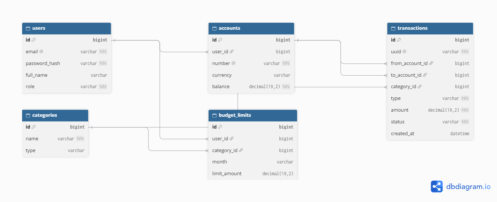

# Banking Simulator

Educational banking and personal finance simulator built as a Java Programming exam project.
No real financial systems or real payment data are used.

## Features
- Registration and login (roles: Customer, Admin)
- Virtual accounts for each client
- Deposits, withdrawals and transfers between accounts
- Atomic transfers (@Transactional, BigDecimal)
- Transaction history with search by type, date and amount
- Expense categories and budget limits
- Monthly income and expense reports

## Tech stack
Java 17, Maven, Spring Boot, Spring Security, Spring Data JPA, MySQL,
HTML/CSS/JavaScript, JUnit 5

## How to run
1. Install Java 17, Maven and MySQL
2. Create a database: `banking_simulator`
3. Set your MySQL login and password in `application.properties`
4. Run: `mvn spring-boot:run`
5. Open: http://localhost:8080

## API endpoints
(to be added)

## Database

## Tests
Run: `mvn test`

## UI mockups

## Roles
- Customer: own accounts, transfers, history, budget limits, reports
- Admin: view all users and accounts

## Authors
Rustem Aitbay, Urgesh Sarbinaz, Zharasbai Nunbek
